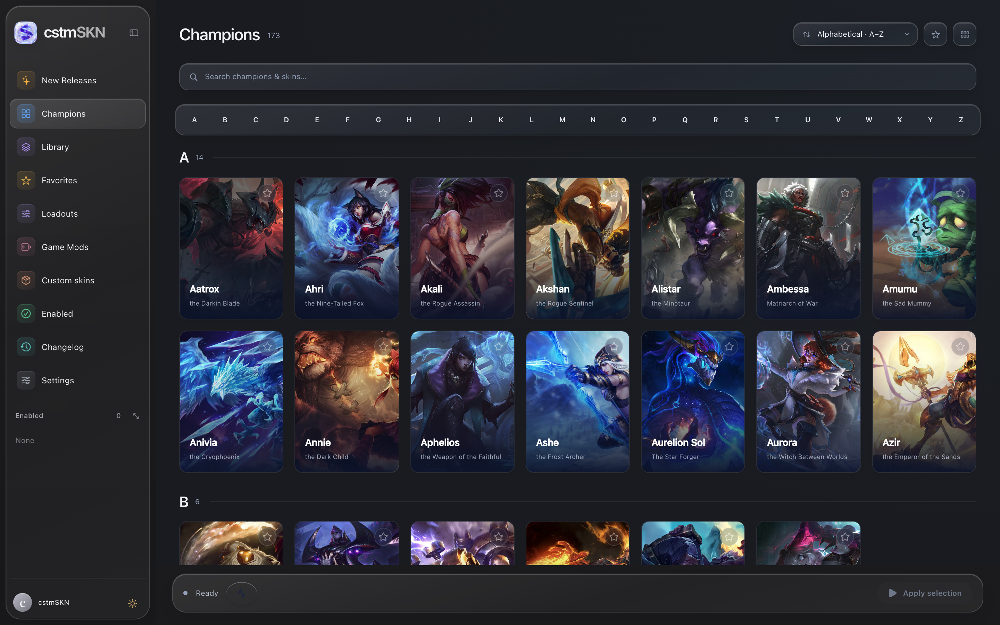
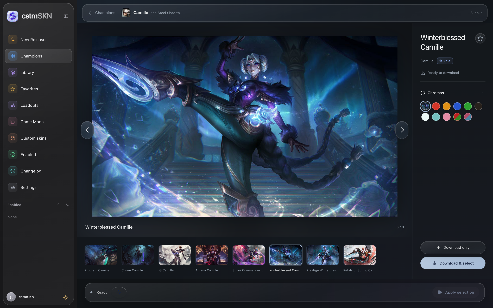
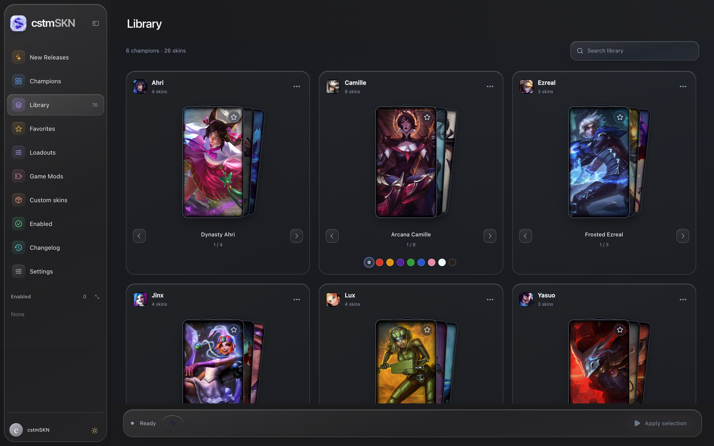
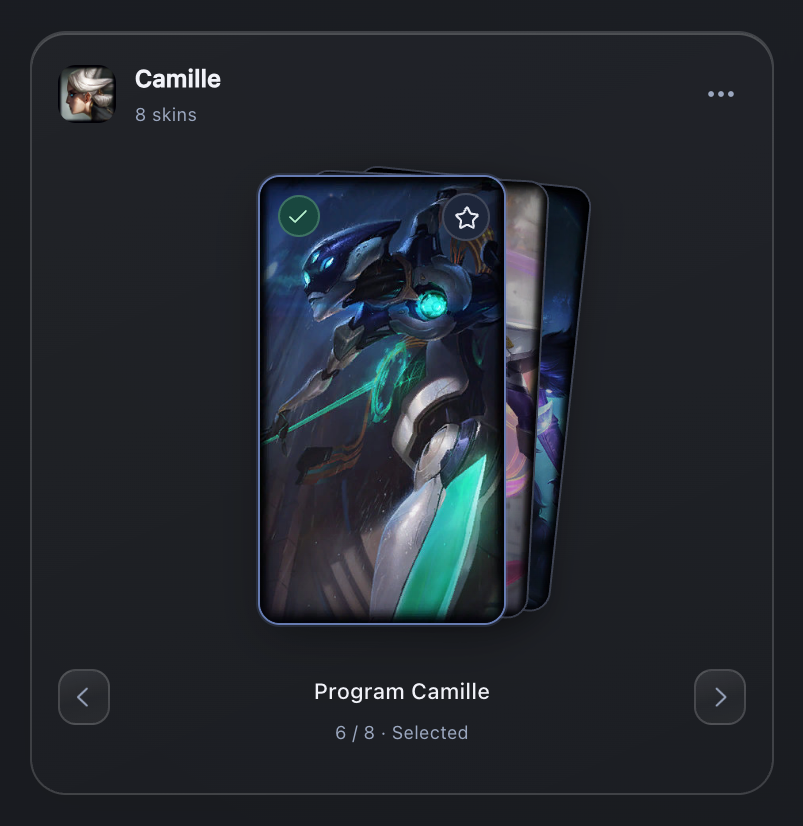
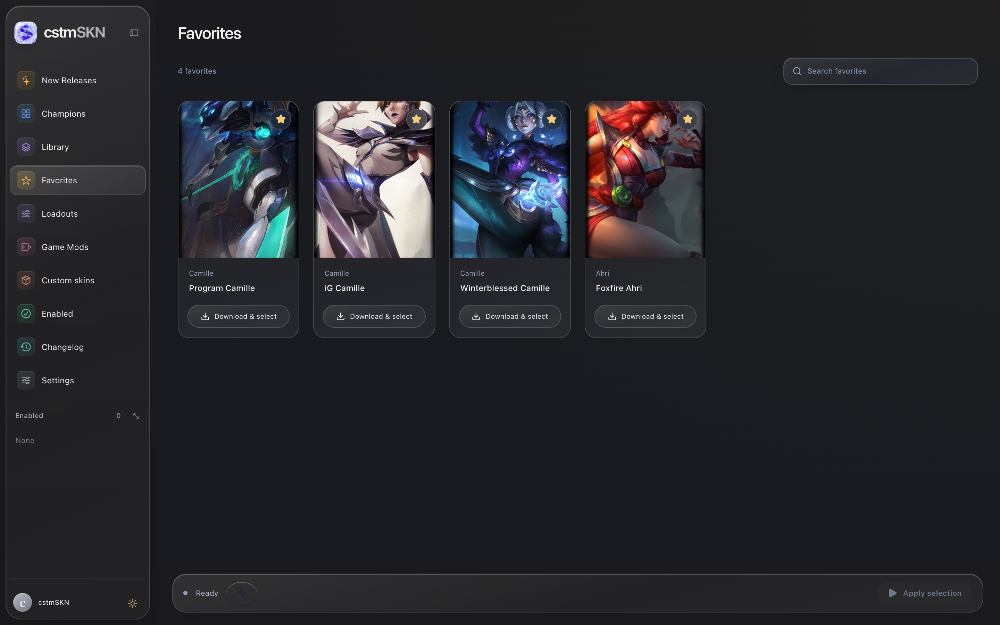
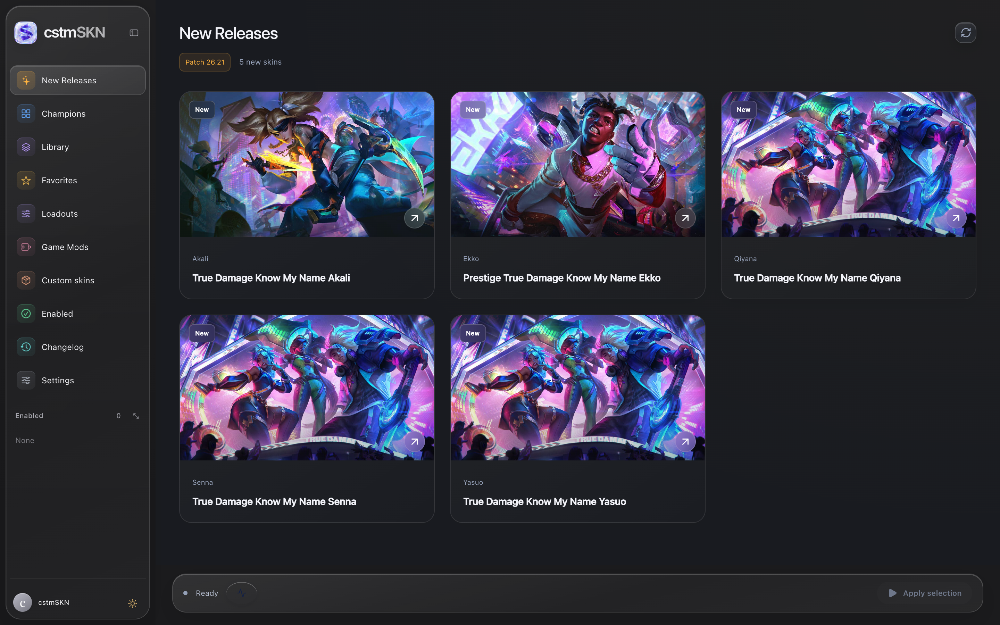
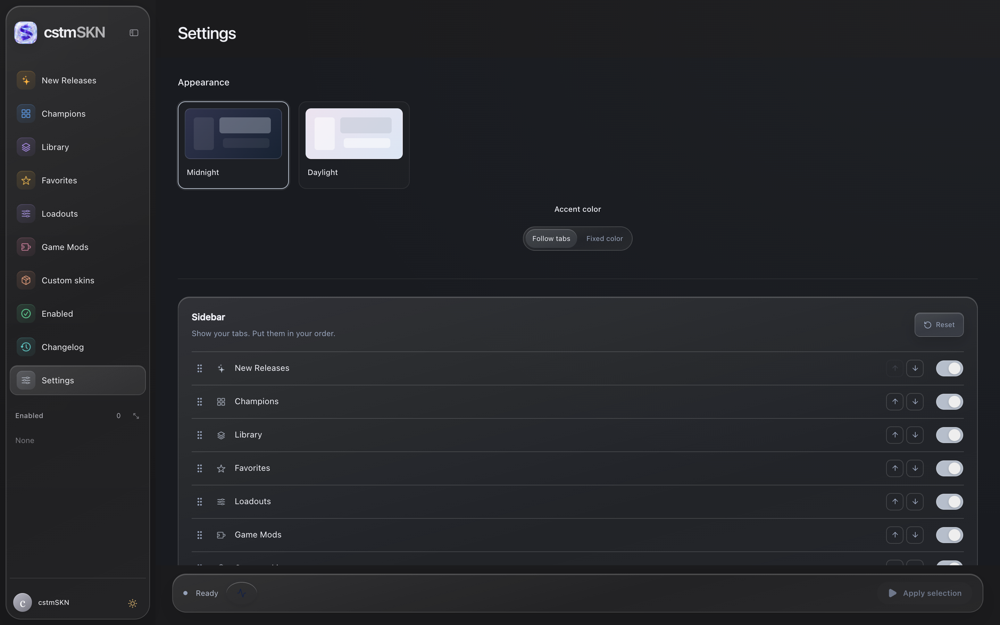
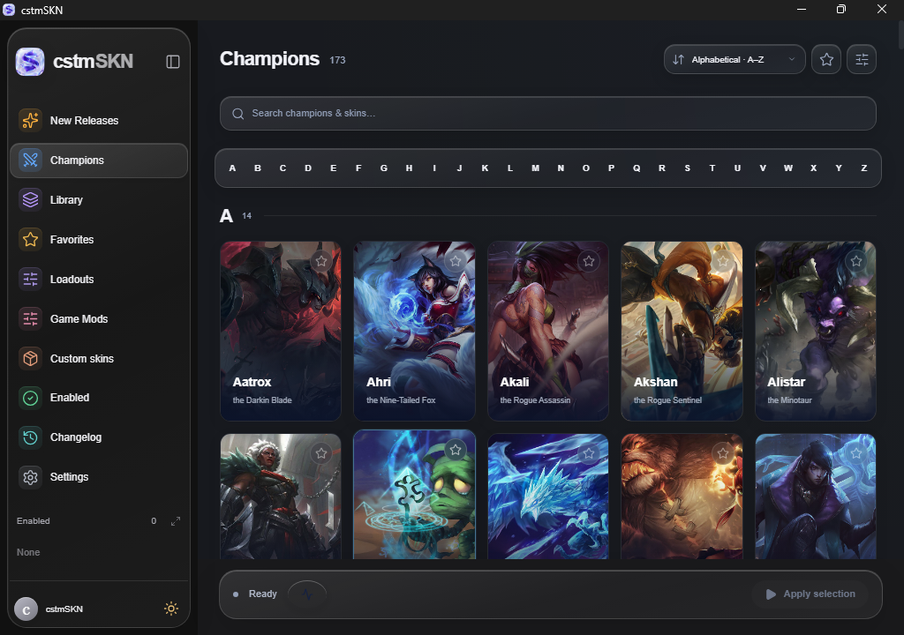
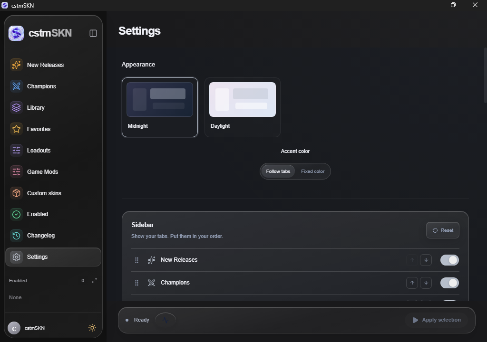
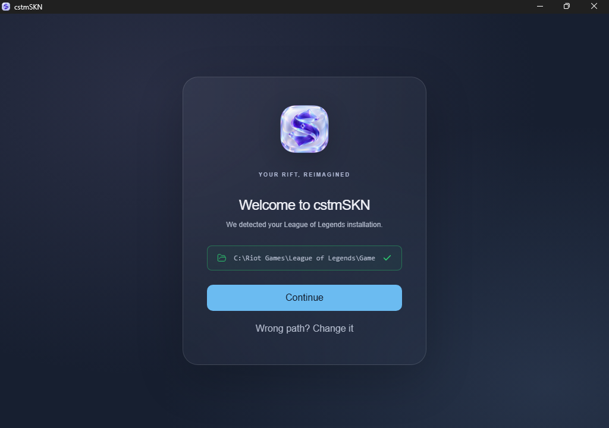

<p align="center"></p>

# cstmSKN

I DONT TAKE CREDIT FOR ANYTHING HERE, THIS VERSION IS BASED, BUILT AND MODIFIED FROM ZUSHI v0.1.14 ALL CREDIT TO HIM: https://github.com/Mouadzz/zushi

[Download the latest release](https://github.com/silentrosehill/cstmSKN/releases/latest)

**Windows preview:** cstmSKN also runs on Windows 11 x64. Get it from the [Windows preview release](https://github.com/silentrosehill/cstmSKN/releases/tag/v1.0.2-windows-alpha.1) ([installer](https://github.com/silentrosehill/cstmSKN/releases/download/v1.0.2-windows-alpha.1/cstmSKN-Windows-x64-setup.exe) or [portable zip, no install](https://github.com/silentrosehill/cstmSKN/releases/download/v1.0.2-windows-alpha.1/cstmSKN-Windows-x64-portable.zip)). It's an early test build; see [WINDOWS.md](WINDOWS.md) for setup and limits.

## Code signing policy

We are applying to the [SignPath Foundation](https://signpath.org/) for an eligibility review. **No approval or SignPath signature has been granted.** Windows builds remain unsigned. The binary-only LTK runtime is disclosed as an eligibility limitation. See our [code signing policy and privacy information](CODE_SIGNING.md).

## Screenshots

<table>
  <tr>
    <td width="50%"><br /><sub>Champions</sub></td>
    <td width="50%"><br /><sub>Skin gallery with chromas</sub></td>
  </tr>
  <tr>
    <td><br /><sub>Library card decks</sub></td>
    <td><br /><sub>One deck per champion</sub></td>
  </tr>
  <tr>
    <td><br /><sub>Favorites</sub></td>
    <td><br /><sub>New Releases</sub></td>
  </tr>
  <tr>
    <td><br /><sub>Settings</sub></td>
    <td></td>
  </tr>
</table>

### Windows preview

<table>
  <tr>
    <td width="50%"><br /><sub>Champions on Windows 11</sub></td>
    <td width="50%"><br /><sub>Settings on Windows 11</sub></td>
  </tr>
  <tr>
    <td><br /><sub>Finds your League install</sub></td>
    <td></td>
  </tr>
</table>

More in [screenshots](screenshots).

## Features

- **Champions**: browse every champion with splash artwork, A–Z sections, release-date sorting and search for champions or skins.
- **Skin gallery**: large previews, chromas, rarity badges, a thumbnail filmstrip and arrow-key navigation, with colors taken from the artwork.
- **Download & select**: one click to download and enable a skin, or **Download only** to save it for later.
- **Library**: one card deck per champion; cycle through your downloaded skins and pick chromas from the swatches.
- **Favorites**: starred skins, chromas and custom imports in one place.
- **Loadouts**: save and restore named sets of skins and mods.
- **New Releases**: the skins added in the current patch.
- **Custom skins & Game Mods**: import `.fantome`, `.zip`, `.wad` or `.wad.client` skins, announcers, voices and maps by drag and drop.
- **Follow champion select**: opens your champion's gallery when you lock in, and follows trades and ARAM rerolls.
- **Patcher health**: checks game files, the patcher, administrator access and storage.
- **Customizable sidebar**: show, hide and reorder tabs, or shrink it to icons.
- **Appearance**: Liquid Glass sidebar on macOS 26, light and dark modes, tab or fixed accent colors.
- **Software Update**: signed updates from GitHub with Update & Restart.
- **Apple Silicon**: patcher support for the latest League client on M-series Macs.

## Install

1. Download **cstmSKN-macOS-arm64.zip** from the [latest release](https://github.com/silentrosehill/cstmSKN/releases/latest) (Apple Silicon Macs).
2. Unzip it and move **cstmSKN.app** to your Applications folder.
3. Open it. The patcher asks for your administrator password through the normal macOS dialog when you apply skins.

### "Apple could not verify cstmSKN"

cstmSKN isn't notarized by Apple, so macOS blocks it the first time you open it. To allow it:

1. Try to open cstmSKN once, then click **Done** on the warning.
2. Open **System Settings → Privacy & Security**, scroll down and click **Open Anyway** next to cstmSKN.
3. Confirm with **Open Anyway** and your password. macOS remembers this, so you only do it once.

Or run this in Terminal after moving the app to Applications:

```sh
xattr -dr com.apple.quarantine /Applications/cstmSKN.app
```

League of Legends and its artwork belong to Riot Games. cstmSKN is not endorsed by or affiliated with Riot Games. Custom skins are used at your own risk.

womp womp vibecoded idc the market sucks make ur own
